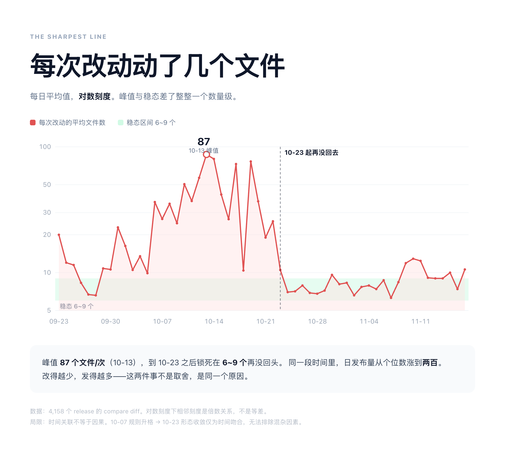
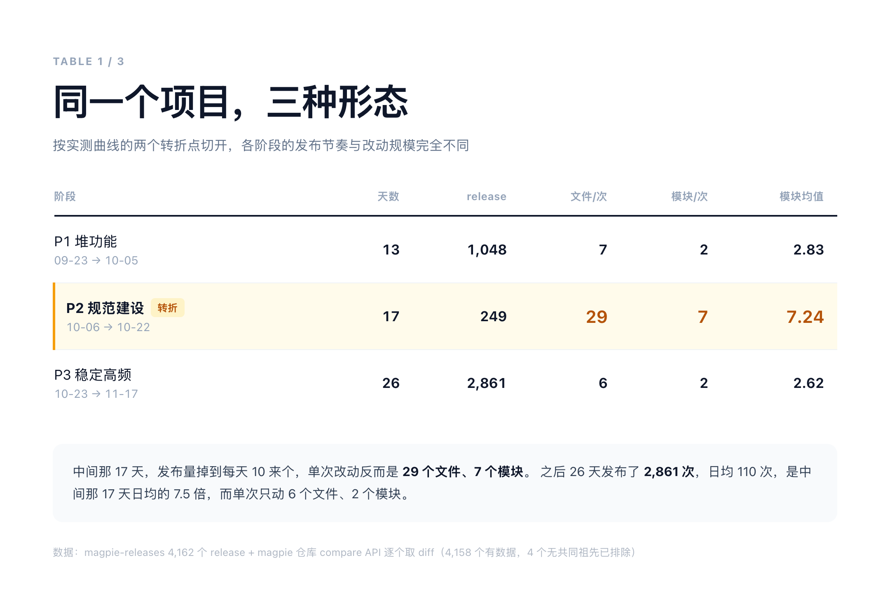
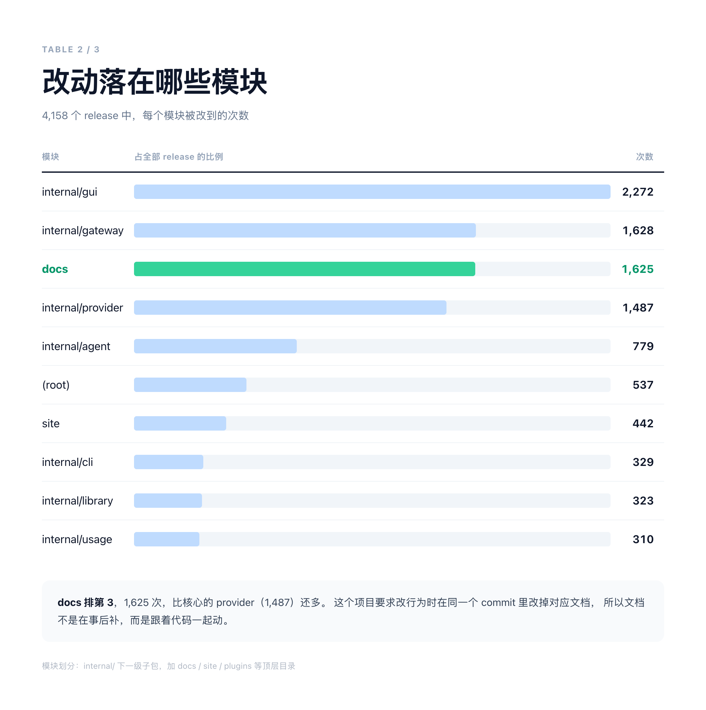

# magpie 发布数据观察

对 [yetone/magpie](https://github.com/yetone/magpie) 全部 **4,162 个 release** 的实测分析。

magpie 自述「code is written, reviewed, merged and released by agents」——
代码由 AI agent 编写、review、合并、发布。它 56 天发了 4,162 个版本，
是一个观察 AI 写代码实际形态的样本。

不看提交说明，直接调 GitHub `compare` 接口取出每个版本真实的文件改动清单，
看代码实际动了多少、动了哪里。

## 三张图

| | |
|---|---|
|  |  |
| 每日发布量 | 每次改动的文件数（对数刻度） |
|  |  |
| 三阶段形态对比 | 改动落在哪些模块 |

另外两张：

- [`images/04-change-size.png`](images/04-change-size.png) —— 改动规模分布
- [`images/05-five-scales.png`](images/05-five-scales.png) —— **五个尺度的改动大小**（每天 release 数 / 每次 release 的文件与模块 / 每个 commit 的文件与模块）

另有整页长图 [`images/06-poster-long.png`](images/06-poster-long.png)：上面六段合成一张。

发推用的五张裁切在 [`images/post-5/`](images/post-5/)：按卡片边界切开，不截断文字。

## 结论

**它先慢下来，然后变得又快又小。**

10-06 到 10-22 的 17 天，发布量从每天 140 掉到 7~27，
单次改动却涨到 **29 个文件 / 7 个模块**。之后 26 天发布量回到每天 100~200，
单次改动压到 **6 个文件 / 2 个模块**，再没回去。

减产那段时间不是在发版，是在重整结构——`LESSONS.md` 记载 10-17 → 10-18 约 3 万行代码移出。

另一个数字：**docs 出现在 1,625 个 release 里，排第 3**，
比核心的 `internal/provider`（1,487）还多。改行为就在同一个 commit 里改掉对应文档。

## 核心数字

| 指标 | 值 |
|---|---|
| release 总数 / 有 diff 数据 | 4,162 / 4,158 |
| 覆盖天数 | 56 天（2026-09-23 → 11-17） |
| 每次改动文件中位数 | 6 |
| 每次改动模块中位数 | 2 |
| 只含 1 个 commit 的 release | 68.2% |
| 只碰 1~2 个模块的 release | 55.4% |
| 文件数峰值 | 87 个/次（10-13） |

三阶段：

| 阶段 | 日期 | 天数 | release | 文件中位 | 模块中位 |
|---|---|---|---|---|---|
| P1 堆功能 | 09-23 ~ 10-05 | 13 | 1,048 | 7 | 2 |
| **P2 规范建设** | 10-06 ~ 10-22 | 17 | 249 | **29** | **7** |
| P3 稳定高频 | 10-23 ~ 11-17 | 26 | 2,861 | 6 | 2 |

## 目录

```
├── images/              6 张成品图（2160px 宽，2 倍图）
├── out/                 分析结果
│   ├── summary.json       关键数字 + 每日序列 + 三阶段（画图读这个就够）
│   ├── daily.csv          每天一行
│   ├── phases.csv         三阶段汇总
│   ├── modules.csv        模块频率排行
│   ├── releases.csv       每个 release 明细（4,158 行）
│   └── dataset.json       完整明细，含每个文件路径
├── scripts/             采集与导出脚本，可复现
├── DATA.md              数据说明：来源、完整性、归类规则、全部数字
└── IMAGE-PROMPTS.md     三张图的生图 prompt
```

## 声明

**4 个 release 缺失**：`v0.1.0`、`v0.1.695`、`v0.1.1220`、`v0.1.1225`
与前一版本无共同祖先，`compare` 无法返回 diff。已排除，未用 0 或空值填充。

**时间关联不等于因果。** 10-07 规则升格 → 10-23 形态收敛只是时间吻合，
无法排除团队规模、产品阶段等混杂因素。数据只能说明「发生了什么」。

## 许可

数据由 GitHub 公开 API 取得，原项目 [yetone/magpie](https://github.com/yetone/magpie) 为 MIT 许可。
本仓库的分析代码与图表同样以 MIT 发布。
